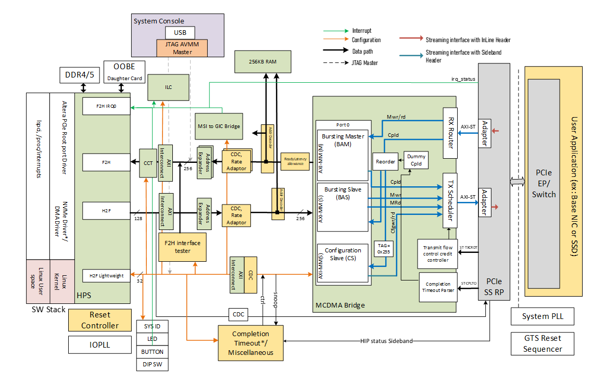

# Agilex™ 5 PCIe Root Port System Example Design

The Agilex™ 5 PCIe Root Port System Example Design targets the [Agilex™ 5 FPGA E-Series 065B Modular Development Kit (MK-A5E065BB32AEA)](https://www.altera.com/products/devkit/po-3274/agilex-5-fpga-and-soc-e-series-065b-modular-development-kit) with a PCIe Gen4x4 root port connected to an NVMe endpoint, using the HPS and Multichannel DMA (MCDMA) bridge.

## Description

The Agilex™ 5 PCIe Root Port System Example Design demonstrates a PCIe Gen4x4 root port on the Altera Agilex™ 5 FPGA E-Series 065B Modular Development Kit, connected to a Non-Volatile Memory express (NVMe) endpoint. The design is intended to serve as a reference for implementing and running a performant root port system using the Agilex™ 5 SoC and relevant IP.

The System Example Design (SED) provides the necessary drivers and user applications to support the Linux stack running on the HPS.

The system's primary components include:

- The Hardware Reference Design
- Hard Processor Subsystem (HPS)
- Multichannel DMA (MCDMA) bridge
- GTS PCIe Root Port Hard IP
- Bridges, interconnects, and adapters for clock crossing, data path, and control path
- Reference HPS software including:
  - Arm Trusted Firmware
  - U-Boot
  - Linux Kernel
  - Linux Drivers
  - User Space Applications



Important features of the design include:

- Linux driver for the PCIe root port IP that runs on the HPS, enumerates the PCIe endpoint(s), and configures the PCIe root port Hard IP through a dedicated reconfiguration AXI-Lite interface
- HPS-to-FPGA (H2F) lightweight AXI4 for CSR access to the HIP reconfiguration interface and the MCDMA Configuration Slave (CS) interface
- Bursting AXI-MM Slave (BAS) path for large memory transactions between the SoC H2F AXI4 interface and the PCIe endpoint
- MSI/MSI-X interrupt handling via the Bursting AXI-MM Master (BAM) interface
- Endpoint-initiated memory requests (DMA bus mastering) targeting system memory via the HPS FPGA-to-HPS (F2H) AXI4 interface

The System Example Design supports the following design configuration on Altera Development Kits.

| SL No | Design configuration              | Link speed / width | Development Kit Supported                                                                                                      | Device Family                | Device Part     | Documentation                            |
| ----- | --------------------------------- | ------------------ | ------------------------------------------------------------------------------------------------------------------------------ | ---------------------------- | --------------- | ---------------------------------------- |
| 1.    | PCIe Root Port with NVMe endpoint | Gen4x4             | [MK-A5E065BB32AEA](https://www.altera.com/products/devkit/po-3274/agilex-5-fpga-and-soc-e-series-065b-modular-development-kit) | Agilex™ 5 E-Series (Group B) | A5ED065BB32AE4S | [Build README](./mk-a5e065bb32aea/pcie-rp/README.md) |

## Repository Structure

Directory Structure Used in This Example Design:

```bash
agilex5-ed-pcie-rp
|--- images/
|--- mk-a5e065bb32aea/
|   |--- pcie-rp/               # PCIe Gen4x4 Root Port, Modular Development Kit
```

The design directory contains `src/`, `syn/`, `sim_example/`, and `software/` (see the design README for details).

## Project Details

- **Family**: Agilex 5
- **Quartus Version**: 26.3
- **Development Kit**: [MK-A5E065BB32AEA](https://www.altera.com/products/devkit/po-3274/agilex-5-fpga-and-soc-e-series-065b-modular-development-kit)
- **Device Part**: A5ED065BB32AE4S
- **Category**: HPS, PCIe
- **Source**: Quartus Prime Pro
- **URL**: https://github.com/altera-fpga/agilex5-ed-pcie-rp
- **Design Package**: a5ed065b-modular-devkit-pcie-rp-gen4x4.zip
- **Documentations**: https://altera-fpga.github.io/latest/embedded-designs/agilex-5/e-series/modular-065b/pcie-rp/ug-pcie_rp-agx5e-modular-065b/

## Documentations

- **Title**: HPS PCIe Root Port System Example Design User Guide: Agilex 5 E-Series 065B Modular Development Kit
  **URL**: https://altera-fpga.github.io/latest/embedded-designs/agilex-5/e-series/modular-065b/pcie-rp/ug-pcie_rp-agx5e-modular-065b/
- **Title**: Design and Build Readme  
  **URL**: [mk-a5e065bb32aea/pcie-rp/README.md](./mk-a5e065bb32aea/pcie-rp/README.md)
- **Title**: Hardware Build (syn)  
  **URL**: [mk-a5e065bb32aea/pcie-rp/syn/g4x4/README.md](./mk-a5e065bb32aea/pcie-rp/syn/g4x4/README.md)
- **Title**: Software / Yocto Build Readme  
  **URL**: [mk-a5e065bb32aea/pcie-rp/software/yocto_linux/README.md](./mk-a5e065bb32aea/pcie-rp/software/yocto_linux/README.md)

## Getting Started

Building the design is easy with the scripts provided in the repo. Clone the repository to get the source files.

```bash
git clone https://github.com/altera-fpga/agilex5-ed-pcie-rp.git
cd agilex5-ed-pcie-rp
git checkout <Release Tag>
```

Follow the links below to compile, build, and test the design solution.

- [Building PCIe Root Port on MK-A5E065BB32AEA](./mk-a5e065bb32aea/pcie-rp/README.md)
- [Software / Yocto (GSRD 2.0)](./mk-a5e065bb32aea/pcie-rp/software/yocto_linux/README.md)

Run `make help` from the design directory for the full target list.
